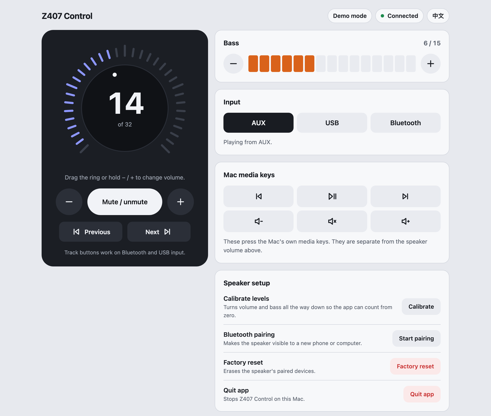

# Logitech Z407 網頁遙控器（macOS 版）

**專為 macOS 打造的 Logitech Z407 喇叭網頁遙控器。**

[English README](README.md)

如果原本的無線控制旋鈕用起來不順手、佔桌面空間，或早就不見了，這個 app 就是為你準備的。我自己的用法很簡單：Z407 透過 AUX 連接 Mac，旋鈕收起來，平常的音量調整直接在 Mac 上操作。只有偶爾想調整低音或切換輸入來源時才需要遙控器，這個 app 就是解決這個問題的：你通常不需要旋鈕，但還是能快速使用它提供的所有功能。

這個 app 在 Mac 上啟動本地網頁伺服器，模擬原本的無線控制旋鈕。它透過藍牙低功耗（BLE）控制 Logitech Z407。適合常見的 Mac 使用場景：音訊走 3.5mm AUX 線，BLE 只用於遙控指令。

## 功能特色

- 完整 Z407 喇叭控制：靜音、音量、低音、輸入來源切換（AUX / USB / 藍牙）、藍牙配對、恢復原廠設定
- 可以拖曳的音量旋鈕：校正一次後，app 就知道目前的位置（音量 32 格、低音 15 格），可以拖曳圓環或點低音格直接跳到指定大小
- 按住 − / + 可以連續調整，也可以用鍵盤操作（↑ ↓ 音量、← → 低音、M 靜音）
- 顯示目前的輸入來源，重啟 app 後仍然記得音量、低音與輸入來源
- 喇叭斷電再開機後會自動重新連線
- 介面有英文和繁體中文，可以在頁面上切換，並支援淺色與深色模式
- macOS 選單列圖示：關掉瀏覽器分頁後 app 仍在背景安靜執行，隨時可從選單列重新開啟頁面
- 手機遙控：啟用 LAN 模式後，同一個 Wi-Fi 下的手機也可以打開同一個頁面
- Mac 媒體鍵：播放／暫停、上一首／下一首、音量、靜音，都在同一個頁面操作
- 完全在 Mac 本機執行，不需要網路連線，資料不會離開你的電腦

## 介面截圖

<p align="center">
  
</p>

## 快速開始

### Mac App

從 [Releases 頁面](../../releases) 下載 `Logitech Z407 Remote Control.app`，解壓縮後開啟。可以把它拖到**應用程式**資料夾，方便日後像一般 Mac app 一樣啟動。

下載檔是給 Apple Silicon 的 Mac（M1 以後）使用的。Intel Mac 請改從 Terminal 執行，或依照下面的說明自行打包。

這個 app 沒有經過 Apple 公證，所以 macOS 會擋下第一次開啟。請這樣放行：

1. 先開啟 app 一次，關掉警告視窗。
2. 到**系統設定 > 隱私權與安全性**，往下捲，按**仍要打開**。

macOS 14 或更早的版本，也可以在 app 上按右鍵選擇**開啟**。如果 macOS 說 app 已損毀，請在 Terminal 執行 `xattr -cr "/Applications/Logitech Z407 Remote Control.app"`，然後再開啟一次。

app 開啟後會在 macOS 選單列顯示圖示，點擊即可重新開啟瀏覽器介面或關閉 app。

### Terminal

```bash
chmod +x run_macos.sh
./run_macos.sh
```

然後在瀏覽器打開 `http://127.0.0.1:8765`。`run_macos.sh` 會自動建立虛擬環境，第一次執行時安裝套件（之後只有 `requirements.txt` 變動時才會重新安裝），然後啟動 app。

### 從原始碼打包

```bash
./build_macos_app.sh
```

這個腳本會先跑測試，再把 app 輸出到 `release/Logitech Z407 Remote Control.app`，並產生一個帶版號的 zip 方便分享。打包出來的 app 會對應你這台 Mac 的處理器架構。

## 建議設定

用 3.5mm AUX 線將 Mac 連接到 Z407。AUX 的音質通常比藍牙好，也能避免高音量時的失真。

## 安全退出

在網頁介面按**結束程式**，或點擊選單列圖示選擇 **Quit**，兩種方式都能正常關閉 app，並中斷與喇叭的連線。

重複開啟 app 不會啟動第二份，只會打開已經在執行的那一份的頁面。

從 Terminal 執行時，按 `Ctrl+C` 退出。避免按 `Ctrl+Z`，那會讓程序暫停而不是關閉。

如果重啟 app 後無法重新連線到 Z407，可以拔掉喇叭電源線，等幾秒後再插回去，這樣可以清除喇叭端的藍牙狀態。

## 手機遙控

要在區域網路上開放 app 存取：

```bash
./run_macos.sh --lan
```

app 會顯示一個 LAN 網址，例如：

```text
http://192.168.1.35:8765
```

在同一個 Wi-Fi 下的手機上打開這個網址即可使用。

可以把這個頁面加到手機主畫面，像 app 一樣使用。

> **備註：** LAN 模式尚未在所有環境下親自測試。可能需要在 Mac 防火牆設定中允許 8765 埠的連入連線。

## 安全性

- 預設只監聽 `127.0.0.1`，Mac 以外的裝置連不進來。
- 其他網站無法操控你的喇叭：app 會拒絕不是從自己頁面送出的請求。
- LAN 模式沒有密碼。同一個網路上的任何人都能調整音量、低音與輸入來源，也能按 Mac 媒體鍵，所以請只在信任的網路上使用。恢復原廠設定和結束程式不開放給其他裝置，只有執行 app 的那台 Mac 可以操作。

## macOS 權限

macOS 可能會要求：

- **藍牙權限**：Terminal、Python 或打包版 app 都可能需要
- **輔助使用權限**：使用 Mac 媒體控制按鈕時需要

如果 Mac 媒體控制無法使用，請檢查**系統設定 > 隱私權與安全性**。

## 進階用法

範例：

```bash
./run_macos.sh --port 9090
./run_macos.sh --lan --port 9090
./run_macos.sh --preferred-input aux
./run_macos.sh --verbose
./run_macos.sh --no-browser
./run_macos.sh --demo
./run_macos.sh --debug-scan --duration 8
```

- `--no-browser`：啟動時不自動開啟瀏覽器分頁。
- `--demo`：模擬一台喇叭，沒有 Z407 或藍牙也能試用或開發介面。
- 在網址後面加上 `?lang=en` 或 `?lang=zh-TW`，可以指定頁面語言。

預設值：

- Host：`127.0.0.1`
- Port：`8765`
- 偏好輸入來源：`aux`
- 日誌：預設安靜模式

如果搜尋裝置失敗，可以使用：

```bash
./run_macos.sh --debug-scan --duration 10 --rounds 3 --pause 3
```

這個指令會列出 macOS 可見的 BLE 裝置，並標出可能是 Z407 的候選裝置。

## 從原始碼建置

執行環境需求：

- Python 3.12+
- `pip`
- `venv`

從原始碼執行：

```bash
python3 -m venv venv
source venv/bin/activate
python -m pip install -r requirements.txt
python app.py
```

開發工具：

```bash
python -m pip install -r requirements-dev.txt
pytest -q
```

專案結構：

- `app.py`：網頁伺服器、喇叭連線與選單列程式
- `z407_ble.py`、`z407_config.py`、`z407_platform.py`：藍牙識別碼、命令列選項、Mac 媒體鍵
- `templates/index.html`、`static/app.css`、`static/app.js`：網頁介面
- `static/i18n.json`：所有介面文字。要新增語言，加入一組相同 key 的翻譯即可，測試會檢查有沒有漏掉的 key。

開發介面時可以用 `python app.py --demo`，不需要接喇叭。

## 致謝

**macOS 版本：**
macOS 適配、目前維護及此 macOS 優先版本由 **LCY000** 製作。此版本從原本的 Linux 網頁 app 發展為以 macOS 為主的應用程式。

**原始 Linux 網頁 App：**
原始實作由 **Androrama** 完成。

**逆向工程：**
特別感謝 **freundTech** 的逆向工程工作，使本專案成為可能。
https://github.com/freundTech/logi-z407-reverse-engineering

**上游專案：**
此版本改編自 `Androrama/Logitech-Z407-Remote-Control-Web-App---Linux`。

## 授權

這個 repository 的程式碼以 [MIT License](LICENSE) 釋出。

本專案最初是從 Androrama 的 Linux 網頁 app fork 而來。該專案聲明可以免費使用與分享、並保留出處，但沒有正式的授權檔。本專案也使用了 freundTech 的協定文件。這些成果屬於原作者，重新使用本專案時請保留上面的致謝。

## 免責聲明

本專案為**非官方**專案，與 Logitech 沒有任何關聯、背書或連結。
「Logitech」為其各自所有者的商標。本軟體依「現狀」提供，不提供任何形式的擔保。

## 贊助與支持

本專案完全免費。使用、分享並保留署名就是最好的支持。

如果覺得好用，歡迎贊助 **LCY000**（macOS 版維護者），任何支持都能幫助投入更多時間在這個專案及後續改進上。

[](https://ko-fi.com/cyouuu)
